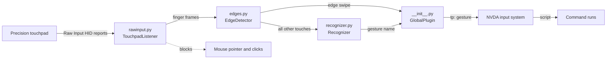

# How Trackpad Gestures works

This document explains what happens between a finger touching the touchpad and NVDA doing something, for anyone who wants to understand, check or change the add-on. For using the add-on, see the [user guide](user-guide.md).

Version described: 0.5.0.

## The path of a gesture

1. **rawinput.py** reads finger positions from the touchpad and turns each report into a *frame*: which fingers are down and where.
2. **edges.py** watches each touch. A short one-finger swipe in from an edge becomes an edge swipe. Every other touch passes straight on.
3. **recognizer.py** turns frames into gesture names such as `swipeRight`, `2fingerDoubleTap` or `swipeUpThenLeft`.
4. **\_\_init\_\_.py** (the NVDA global plugin) wraps each name in an NVDA input gesture, `tp:swiperight`, and hands it to NVDA. NVDA looks up which command is assigned to it and runs it, exactly as it does for a key press.

Steps 1 to 3 run on the add-on's own background thread. Commands run on NVDA's main thread, as they do for the keyboard.

## Files

| File | What it does | Depends on |
| --- | --- | --- |
| `rawinput.py` | Reads the touchpad through Windows Raw Input; blocks the mouse pointer | Windows, NVDA's log |
| `edges.py` | Detects edge swipes | Nothing (plain Python) |
| `recognizer.py` | Turns finger frames into gesture names | Nothing (plain Python) |
| `__init__.py` | NVDA plugin: commands, reading controls, settings, gesture list | NVDA |
| `systemPanels.py` | Reads the taskbar position; chooses what each edge swipe reaches | Windows registry |
| `winGestures.py` | Turns Windows' own three and four finger gestures off and back on | Windows registry |

`recognizer.py` and `edges.py` are shared, unchanged, with Setu Trackpad Gestures, the Linux version for the Orca screen reader. They must not import anything from NVDA, Orca, Windows or Linux.

## 1. Reading the touchpad (rawinput.py)

### Why Raw Input

Windows does not pass touchpad finger positions to programs; it turns them into mouse movement, scrolling and its own gestures. But a *precision touchpad* also reports itself as a HID digitizer (usage page 0x0D, usage 0x05, "Touch Pad"). A program can ask for those reports with the Raw Input API, and receive the position of every finger.

### The listener thread

`TouchpadListener` is a thread with its own hidden message-only window. On start it:

1. registers for touchpad raw input with `RIDEV_INPUTSINK`, so reports arrive whichever window is in front;
2. installs a low-level mouse hook (see below);
3. starts a 40 millisecond timer, which drives timing decisions such as "was that a single tap or the start of a double tap?";
4. runs a normal Windows message loop until it is stopped.

It uses private copies of `user32`, `kernel32` and `hid` through ctypes, so it never changes the settings NVDA's own code relies on. All structures are declared with Windows' own type sizes, so the same code works with 32-bit and 64-bit NVDA.

### Reading a report

Each `WM_INPUT` message carries one or more HID reports. The HID parser in `hid.dll` (the `HidP_*` functions) reads them using the touchpad's own description of its report layout, so no touchpad-specific code is needed:

- **Contact count** (usage 0x54): how many fingers this frame describes.
- For each finger slot (a HID *link collection*): **Contact ID** (0x51), **Tip switch** (0x42, the finger is touching), **Confidence** (0x47, the touchpad thinks it is a finger rather than a palm), and **X** and **Y** (generic desktop 0x30 and 0x31).

X and Y are scaled to 0 to 1 using each touchpad's own range. The touchpad's height divided by its width (its *aspect*, from the physical size it reports) is kept so distances can be compared fairly in both directions.

### Assembling frames

Some touchpads send all fingers in one report; others send a few fingers per report ("hybrid mode"), with the contact count only in the first. The listener collects slots until it has as many as the count says, then passes the whole frame on. A contact that the touchpad marks as not confident is dropped, which filters out palms while typing.

### Blocking the pointer

While gestures are on, the touchpad would still move the pointer and click, and NVDA would read whatever the pointer passed over. A low-level mouse hook (`WH_MOUSE_LL`) blocks mouse input that does not come from a program. Input that programs inject, including NVDA's own mouse commands, has the injected flag and is let through.

With "Allow an external mouse" on, mouse input is blocked only while a finger is on the touchpad and for 0.6 seconds after, so a USB mouse keeps working.

Windows' own three and four finger gestures do not come through the mouse, so the hook cannot stop them; `winGestures.py` turns them off instead (section 6).

## 2. Edge swipes (edges.py)

`EdgeDetector` sits in front of the recognizer and offers the same three things the listener uses: `feed`, `tick` and `touching`. Every frame goes on to the recognizer. When all fingers lift, the detector checks the touch that just ended against these rules:

| Rule | Value |
| --- | --- |
| Fingers | One, from touch down to lift |
| Start | In the outer 10% of the touchpad: top, bottom, left or right band |
| Direction | Inward: down from the top, up from the bottom, right from the left edge, left from the right edge |
| Distance inward | At least 5% and at most 40% of the touchpad in that direction |
| Time | Under 0.8 seconds |
| Straightness | Inward movement larger than sideways movement, compared in real distance using the aspect |
| Corners | On the top and bottom edges, a start in the left 28% is the left corner, in the right 28% the right corner |

When a touch qualifies, the detector drops the recognizer's record of that touch (its `_session`), so the recognizer reports nothing for it, and calls `onEdge(name, part)` instead. `part` says where along the edge the swipe started (`start`, `middle` or `end`); it lets a taskbar on the left or right side use three places on one edge.

Longer swipes, slow swipes and taps near an edge do not qualify, so they reach the recognizer unchanged.

The eight names are `edgeSwipeTopLeft`, `edgeSwipeTop`, `edgeSwipeTopRight`, `edgeSwipeBottomLeft`, `edgeSwipeBottom`, `edgeSwipeBottomRight`, `edgeSwipeLeft` and `edgeSwipeRight`.

## 3. Recognising gestures (recognizer.py)

The recognizer receives frames and reports gesture names. It knows nothing about NVDA.

### Sessions

A *session* starts when the first finger touches and ends when the last finger lifts. During a session the recognizer records, for each finger, where it started, where it is now and the furthest it has moved; the largest number of fingers down at once; and, for one finger, the path it took.

### Deciding what a session was

| Gesture | How it is recognised |
| --- | --- |
| Tap | Fingers moved less than 6% of the touchpad width, and lifted within 0.30 seconds (one finger) or 0.45 seconds (two to four) |
| Double and triple tap | Another tap with the same number of fingers within 0.35 seconds of the last. A tap is reported only once 0.35 seconds pass with no further tap |
| Swipe | Moved at least 14% of the width in under 1.2 seconds. Several fingers: their average movement. The direction is whichever of up, down, left or right is largest |
| Two-part swipe | One finger whose path turns a corner. The corner is the point furthest from the straight line between start and end (or, for "up then down" and similar, the point furthest from the start). Both parts must be at least 8% long and go in different directions |
| Double tap and hold | A tap, then a second touch held still for at least 0.5 seconds |
| Long press (two to four fingers) | Fingers held still for 0.5 seconds. Reported while the fingers are still down |
| Explore | One finger held still for 0.35 seconds, then moved. Reports the finger's position about every 50 milliseconds, and nothing when it lifts |
| Zones | A double tap (one to four fingers) or long press (two to four) whose centre is within 22% of an edge gets the edge's name added, for example `doubleTapLeft` |

Distances use the touchpad's real proportions, so a swipe of the same physical length counts the same across and down. A session with no reports for 3 seconds is dropped, in case the lift report was lost.

## 4. From gesture to command (__init__.py)

### NVDA input gestures

`TrackpadGesture` is an NVDA `InputGesture` whose identifier is `tp:` plus the gesture name, for example `tp:2fingerdoubletap`. It is registered as a gesture source, so NVDA's input help (NVDA+1) and the Input gestures dialog show it by its spoken name, such as "2-finger double tap near the top edge".

The listener calls `inputCore.manager.executeGesture` with it, as NVDA's own keyboard code does with key presses. NVDA then finds the command, runs it, cancels speech first as it does for keys, and handles input help and sleep mode.

### Zones fall back

When a zone gesture has no command of its own, the plugin sends the plain gesture instead, so `doubleTapLeft` activates like `doubleTap` until it is given a command.

### Where assignments are kept

Default assignments are written on each command with NVDA's `@script` decorator. Changes made in the add-on's settings are written to NVDA's own user gesture map (`gestures.ini` in the NVDA settings folder). That is the same place NVDA's Input gestures dialog uses, so the two always agree, and a change in either shows in the other.

### Commands that press keys

Many commands press keys through `inputCore.manager.emulateGesture`. This means that if NVDA has a command on that key (for example `h` for next heading in browse mode), NVDA's command runs; otherwise the key goes to Windows.

### Next item: choosing what fits

The "next item" command (swipe right) looks at what has focus and chooses:

| Where focus is | What it does |
| --- | --- |
| Browse mode (web pages, documents) | Down Arrow |
| Lists, trees, menus (for example files in a folder) | Down Arrow |
| Tabs, the menu bar, table cells, Excel cells | Right Arrow |
| Documents and multi-line text (Word, Notepad) | Down Arrow |
| Single-line text fields, PowerPoint | Tab |
| Anything else (dialogs, buttons) | Next object in NVDA's object navigation, which also reaches text that Tab skips |

The "Swipe right and left moves by" setting can replace this with object navigation everywhere, or Tab everywhere. Double tap activates whatever was reached: Enter in browse mode and lists, otherwise NVDA's "activate the navigator object".

### Reading controls

Reading controls work like TalkBack's. Swipe up and down move by the selected control. Characters, words and lines use NVDA's review cursor commands, the same as Numpad 1 and 3, 4 and 6, and 7 and 9, unless selection mode is on or the setting says to use the system cursor. Headings, links and the other element types use NVDA's browse mode single-letter commands. Excel-only and PowerPoint-only controls are skipped in other apps. The user's order and the controls they have turned off are kept in NVDA's configuration.

### Back to the application

The plugin listens to NVDA's foreground and focus events and remembers the last real application window, leaving out the taskbar, desktop, Start, Task View and NVDA's own windows. It also remembers the last focus in a work area: a document, editable text, a table or Excel cell, or a list item.

The two-finger long press then:

1. brings that application to the front if another window is in front;
2. if focus is in the ribbon or a menu, presses Escape;
3. otherwise moves focus back to the remembered work area, or presses F6 to move through the panes until it reaches one.

It checks again after each step, 250 milliseconds apart, and stops after six steps. It never presses Escape in a dialog, so nothing is lost by accident.

## 5. System panels (systemPanels.py)

On every edge swipe, the add-on reads the desktop layout:

- **Windows version**: build 22000 or later is Windows 11.
- **Taskbar edge**: `HKEY_CURRENT_USER\Software\Microsoft\Windows\CurrentVersion\Explorer\StuckRects3`, value `Settings`, byte 12: 0 left, 1 top, 2 right, 3 bottom.
- **Windows 11 taskbar alignment**: `...\Explorer\Advanced`, value `TaskbarAl`: 0 left, 1 centred. Recorded in the log; it does not change any action, because every action uses a keyboard shortcut rather than a screen position.

Then `actionFor` chooses the action:

| Edge | Start corner | Middle | End corner |
| --- | --- | --- | --- |
| The taskbar's edge | Start button | Taskbar apps (Windows+T) | System tray (Windows+B) |
| Top (bottom if the taskbar is at the top) | Ribbon or menu bar (Alt) | Notifications (Windows+N) | Quick settings (Windows+A) |
| Left, with no taskbar there | Widgets (Windows+W) | | |
| Right, with no taskbar there | Notification centre (Windows+N) | | |

On a side taskbar, the corners are the top and bottom ends of that edge. On Windows 10, notifications and quick settings both use the Action Center (Windows+A), and the left edge opens Task View (Windows+Tab), as Windows 10 touch screens do.

The Start button has no shortcut that focuses it without opening the menu, so the add-on asks UI Automation to focus the element with automation ID `StartButton` on the taskbar window. If that fails, it goes to the taskbar apps instead.

**First and second swipe.** 400 milliseconds after the first swipe, the add-on checks that focus arrived: for the taskbar, that the focus, the foreground window or one of the focus's parents has one of the taskbar window classes (`Shell_TrayWnd`, `Shell_SecondaryTrayWnd`, `NotifyIconOverflowWindow`, `TopLevelWindowForOverflowXamlIsland`); for the ribbon, that focus is in a ribbon or menu; for the other panels, that a new window came to the front. If it arrived, the add-on remembers the swipe for 20 seconds. The same swipe again within that time, while focus is still there, presses Enter (for the Start button, Control+Escape if focus has moved off it). Any other gesture forgets it. If focus did not arrive, the add-on says so and writes the details to the NVDA log.

## 6. Windows' own gestures (winGestures.py)

Windows' three and four finger swipes and taps would fire at the same time as the add-on's. They are stored per user under `HKEY_CURRENT_USER\Software\Microsoft\Windows\CurrentVersion\PrecisionTouchPad`, in `ThreeFingerSlideEnabled`, `ThreeFingerTapEnabled`, `FourFingerSlideEnabled` and `FourFingerTapEnabled`, where 0 means "Nothing".

When gestures turn on, the add-on saves the old values in NVDA's configuration (straight away, so they survive NVDA closing unexpectedly), sets all four to 0, and tells Windows the settings changed. When gestures turn off, it puts the old values back, removing any that did not exist before. If NVDA starts and finds saved values from a session that did not end properly, it puts them back.

## 7. Settings

Settings are kept in NVDA's configuration under `[trackpadGestures]`:

| Key | Meaning | Default |
| --- | --- | --- |
| `enableAtStart` | Turn gestures on when NVDA starts | off |
| `swipeStyle` | `smart`, `object` or `tab` | `smart` |
| `textMovement` | `review` (numpad style) or `caret` | `review` |
| `exploreByTouch` | Explore by touch and hold | on |
| `blockPointer` | Block the pointer and clicks while on | on |
| `allowExternalMouse` | Let a USB mouse work while on | off |
| `disableWindowsGestures` | Turn Windows' own three and four finger gestures off while on | on |
| `savedWindowsGestures` | Windows' values to put back (internal) | empty |
| `readingControlOrder` | All reading controls, in the user's order | all, built-in order |
| `readingControlsOff` | Reading controls the user turned off | sentences, objects, buttons, edit fields, lists, tables, graphics, system tray |

Gesture assignments are not here; they are in NVDA's gesture map (section 4).

## 8. Cost

The add-on runs inside NVDA's process; it starts one thread and one hidden window. With no finger on the touchpad it only wakes for the 40 millisecond timer. While touching, it parses roughly 100 to 150 small reports a second. The memory it adds is expected to be a few megabytes; this has not yet been measured on real hardware.

## 9. Limits

- Only precision touchpads report finger positions this way. Older touchpads with their own drivers (some Synaptics and ELAN models) do not, and the add-on says so when it cannot find one.
- Raw input only reaches the add-on while NVDA is running in the same Windows session. It does not work on the Windows sign-in screen or secure screens, and the add-on does not start there.
- Windows may need a sign-out before the change to its three and four finger gestures takes effect on some machines.
